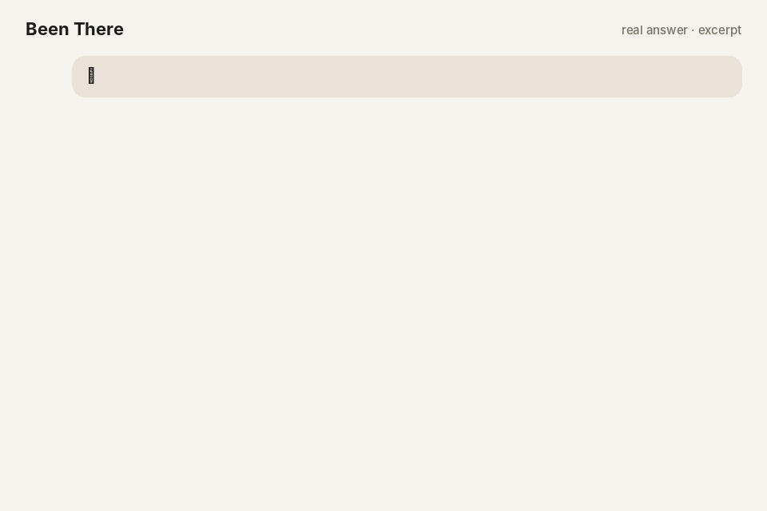

# Been There

**Someone has probably tried your plan already. Find out how it ended before you do.**

[](#install)
[](been-there/SKILL.md)
[](evals/results/)
[](LICENSE)
[](CONTRIBUTING.md)

*[Español abajo](#español)*

A Claude skill (Agent Skill / Claude Code plugin) for decisions that matter that matter: pricing changes, hires, launches, expansions, big orders. It checks your plan against companies that tried something similar (the ones that failed *and* the ones that survived), finds the assumption most likely to sink it, and gives you a short verdict you can act on.



<sub>Excerpt of a real answer from the eval run: [`H01.md`](evals/results/2026-11-24-v0.2-hard/been-there/H01.md).</sub>

## What you get

```
Verdict:            Not as planned. First find out X, then scale in stages. · Confidence 7/10
Hidden assumption:  The number your plan silently depends on (and you didn't mention)
Precedents:         × Who failed this way   ✓ Who survived it, and how
Next step (48 h):   A cheap test that would reveal the problem
Kill criterion:     If <measurable signal> by <date>, change course
```

Under ~400 words by default. Ask for a `full review` to see the whole reasoning.

## Why it's different

- **Hunts the unstated assumption.** Plans rarely fail on what founders write down. Been There lists what your plan silently depends on (asset lifespan, cost after a change, how long customers stay, whether your sales cycle fits your runway) and checks it.
- **Real precedents, both sides.** Failures and survivors, with the similarity spelled out (market, model, timing, mechanism). Weak analogies are dropped, not forced.
- **Not a pessimist.** When there's real user pull (paying users, renewals, a waitlist), it says so first. Being wrongly negative counts as a failure too.
- **Ends in action:** a 48-hour test and a dated kill criterion, not a list of "considerations".
- **Bilingual** (EN/ES) and an **open precedent library** (35 sourced cases: 23 failures, 12 survivors, incl. EU and Spain) anyone can add to.

## Meet the Crew

Five regulars look at every plan, plus 1–2 specialists picked for the topic. Vera chairs and writes the verdict. Each one answers on its own before seeing the others.


Say `yes` to the visual report and you get a one-page HTML report with the verdict, the precedents and the Crew's positions (English or Spanish, works offline):


## Tested, blind

37 cases, each answered by plain Claude and by Claude with Been There in fresh sessions, then scored blind by a separate grader. All raw answers are in [`evals/results/`](evals/results/).

| Case set | Flaw found (plain → Been There) | Judged better (plain / Been There / tie) | Avg length (plain → Been There) |
|---|---|---|---|
| Real failures, hidden flaw (8 + 4 controls) | 7/8 → **8/8** | 1 / **6** / 5 | 815 → **590 words** |
| Fictional, flaw in the numbers (8 + 4 controls) | 8/8 → 8/8 | 3 / **4** / 5 | 720 → **565 words** |

Honest read: Claude is already good at spotting flaws. Been There's edge is a tighter, more useful answer: real precedents, a cheap next test, a kill criterion, and no pessimism on good plans. It's also shorter.

## Install

Been There is one thing packaged two ways: a **skill** for the Claude app (web, desktop and mobile chats) and a **plugin** for Claude Code. What's inside is the same. Pick the row that matches where you use Claude:

| Where you use Claude | Install | How |
|---|---|---|
| **Claude app chats**: claude.ai, Claude Desktop, iPhone/Android | Skill (ZIP) | 1. [Download `been-there.zip`](https://github.com/koaling/been-there/raw/main/dist/been-there.zip) (don't unzip it).<br>2. In Claude, open **Settings → Capabilities → Skills** and upload the ZIP.<br>3. Done. The mobile app picks it up from your account; you can't upload from the phone, but you can use it there. |
| **Claude Code**: terminal, VS Code, JetBrains, or the Code tab in Claude Desktop | Plugin | Type these two lines in Claude Code, one at a time:<br>`/plugin marketplace add koaling/been-there`<br>`/plugin install been-there@been-there`<br>Then restart Claude Code. |

Don't see **Skills** in settings? Your plan or your organization may not have it enabled yet. Menu names can change slightly between app versions.

**Check it works:** start a new chat and type `Been there? We want to open a second shop next month.` You should get a **Verdict** with a confidence score and a list called **The Crew**. If Claude just answers normally, the skill isn't on: check the toggle in Settings → Capabilities → Skills.

**Update:** in the app, delete the old skill and upload the new ZIP. In Claude Code: `/plugin marketplace update been-there`, then `/plugin update been-there@been-there`.

## Use

Write your plan in a normal chat and start with a trigger phrase. That's it.

**Trigger phrases:** `Been there?`, `Has anyone tried this?`, `Pressure-test this:`, `Pre-mortem this:`, `Where am I wrong?`. In Spanish: `¿Alguien lo ha intentado?`, `Ponlo a prueba:`, `Dime dónde me equivoco`.

**Examples you can copy:**

```
Been there? We're a 6-person agency. We want to stop client work and build our own SaaS, paid from savings (8 months of runway).
```
```
Pressure-test this: hire a VP of Sales now. The founders close every deal themselves today, around €20k per year per customer.
```
```
Where am I wrong? Our café is full at weekends, so we're opening a second one in another neighbourhood.
```
```
Has anyone tried this? Switching all customers from per-seat pricing to a flat €99/month.
```
```
¿Alguien lo ha intentado? Lanzar una app de suscripción para padres a 4,99 €/mes sin haberla probado con usuarios.
```

**Modes:**

| Type | You get |
|---|---|
| `Been there? <plan>` | The short verdict (under ~400 words). |
| `Quick check: <plan>` | An even shorter answer, for small, reversible decisions. |
| `Full review: <plan>` | Every step: precedents, each Crew member's opinion, the blind cross-review, the debate and the pre-mortem. |
| After any answer: `Make the visual report` | The one-page HTML report with the Crew (see above). |
| `Make the visual report to share with my boss for Monday's meeting` | The same report with who prepared it and who it's for, ready to share. |

**Tips for a better answer:** include your numbers (price, costs, customers, runway), what happens if you do nothing, and when you have to decide. If something important is missing, Been There asks up to 3 short questions first.

## Examples

Real, unedited answers: [a hardware fleet rollout](examples/01-scooter-rollout.md), [a switch to flat pricing](examples/02-flat-pricing.md) [a first sales hire that holds up](examples/03-first-sales-hire.md) and, in Spanish, [a company rename](examples/04-cambio-de-nombre.md) (fictional company, real precedents).

## Contribute

The precedent library is the heart of the project, and adding one company is a 10-minute first PR. See [CONTRIBUTING.md](CONTRIBUTING.md) or [open a precedent suggestion](https://github.com/koaling/been-there/issues/new?template=new-precedent.yml). Most wanted: more survivors, Spanish and LatAm cases, and regulatory failures.

Got a bad answer? [Report it](https://github.com/koaling/been-there/issues/new?template=bad-answer.yml): it becomes an eval case.

If Been There saved you from a bad call, a ⭐ helps others find it.

---

## Español

**Alguien ya intentó tu plan. Descubre cómo le fue antes de descubrirlo tú.**

Una skill de Claude para decisiones importantes: cambios de precio, contrataciones, lanzamientos, expansiones o pedidos grandes. Compara tu plan con empresas que intentaron algo parecido (las que fracasaron y las que sobrevivieron), encuentra el supuesto con más probabilidades de hundirlo y te da un veredicto corto y accionable:

- **Busca el supuesto que no has dicho**, el número del que depende tu plan sin que lo menciones.
- **La Pandilla**: cinco personajes (Nix, Root, Nova, Pip y Tack) más especialistas opinan por separado y Vera decide.
- **Precedentes reales de los dos lados**, explicando en qué se parecen a tu caso y en qué no.
- **No es pesimista**: si hay tracción real, lo dice primero.
- **Termina en acción**: una prueba de 48 horas y un criterio con fecha para cambiar de rumbo.

### Instalación

Es lo mismo empaquetado de dos formas: **skill** para los chats de la app de Claude y **plugin** para Claude Code.

- **Chats de Claude (web, Claude Desktop, móvil):** [descarga `been-there.zip`](https://github.com/koaling/been-there/raw/main/dist/been-there.zip) sin descomprimirlo. En Claude, ve a **Ajustes → Capacidades → Skills** y súbelo. En el móvil aparece solo, porque va con tu cuenta. Desde el móvil no se puede subir, pero sí usar.
- **Claude Code (terminal, VS Code o la pestaña Code de Claude Desktop):** escribe en Claude Code, de una en una:
  `/plugin marketplace add koaling/been-there` y `/plugin install been-there@been-there`. Después reinicia Claude Code.

**Para comprobar que funciona,** abre un chat nuevo y escribe `¿Alguien lo ha intentado? Abrir una segunda tienda el mes que viene.` Debe salir un **Veredicto** con su confianza y **La Pandilla**.

### Uso

Escribe tu plan y empieza con `¿Alguien lo ha intentado?`, `Ponlo a prueba:` o `Dime dónde me equivoco`. Ejemplos:

```
¿Alguien lo ha intentado? Somos una agencia de 6 personas y queremos dejar los clientes para crear nuestro propio SaaS con 8 meses de ahorros.
```
```
Ponlo a prueba: contratar ya un director comercial. Hoy cerramos las ventas los fundadores, unos 20.000 € al año por cliente.
```
```
Dime dónde me equivoco: nuestra cafetería se llena los fines de semana, así que abrimos una segunda en otro barrio.
```

Modos: `chequeo rápido: <plan>` da la respuesta más corta, y `revisión completa: <plan>` muestra todos los pasos. Después de cualquier respuesta puedes pedir `hazme el informe visual` o `hazme el informe para compartirlo con mi jefe en la reunión del lunes`.

Consejo: pon tus números (precio, costes, clientes, caja), qué pasa si no haces nada y cuándo tienes que decidir.

Contribuir: añade una empresa en un YAML siguiendo [`precedents/SCHEMA.md`](been-there/precedents/SCHEMA.md). Se buscan especialmente casos europeos y españoles.

## License

Code and skill: MIT. Precedent library: CC BY 4.0.
