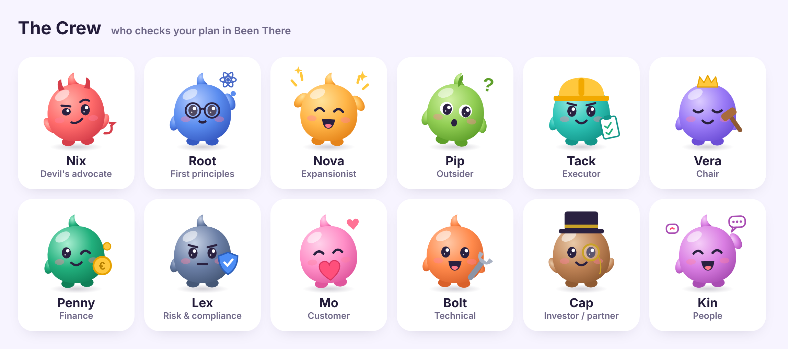
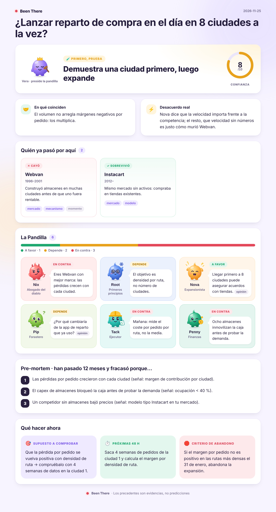

# Been There

**Someone has probably tried your plan already. Find out how it ended before you do.**

[](#install)
[](been-there/SKILL.md)
[](evals/results/)
[](LICENSE)
[](CONTRIBUTING.md)

*[Español abajo](#español)*

A Claude skill (Agent Skill / Claude Code plugin) for decisions that matter that matter: pricing changes, hires, launches, expansions, big orders. It checks your plan against companies that tried something similar (the ones that failed *and* the ones that survived), finds the assumption most likely to sink it, and gives you a short verdict you can act on.


<sub>Excerpt of a real answer from the eval run: [`H01.md`](evals/results/2026-11-24-v0.2-hard/been-there/H01.md).</sub>

## What you get

```
Verdict:            Not as planned. First find out X, then scale in stages. · Confidence 7/10
Hidden assumption:  The number your plan silently depends on (and you didn't mention)
Precedents:         × Who failed this way   ✓ Who survived it, and how
Next step (48 h):   A cheap test that would reveal the problem
Kill criterion:     If <measurable signal> by <date>, change course
```

Under ~400 words by default. Ask for a `full review` to see the whole reasoning.

## Why it's different

- **Hunts the unstated assumption.** Plans rarely fail on what founders write down. Been There lists what your plan silently depends on (asset lifespan, cost after a change, how long customers stay, whether your sales cycle fits your runway) and checks it.
- **Real precedents, both sides.** Failures and survivors, with the similarity spelled out (market, model, timing, mechanism). Weak analogies are dropped, not forced.
- **Not a pessimist.** When there's real user pull (paying users, renewals, a waitlist), it says so first. Being wrongly negative counts as a failure too.
- **Ends in action:** a 48-hour test and a dated kill criterion, not a list of "considerations".
- **Bilingual** (EN/ES) and an **open precedent library** (30 sourced cases: 20 failures, 10 survivors, incl. EU and Spain) anyone can add to.

## Meet the Crew

Five regulars look at every plan, plus 1–2 specialists picked for the topic. Vera chairs and writes the verdict. Each one answers on its own before seeing the others.



Say `yes` to the visual report and you get a one-page HTML report with the verdict, the precedents and the Crew's positions (English or Spanish, works offline):



## Tested, blind

37 cases, each answered by plain Claude and by Claude with Been There in fresh sessions, then scored blind by a separate grader. All raw answers are in [`evals/results/`](evals/results/).

| Case set | Flaw found (plain → Been There) | Judged better (plain / Been There / tie) | Avg length (plain → Been There) |
|---|---|---|---|
| Real failures, hidden flaw (8 + 4 controls) | 7/8 → **8/8** | 1 / **6** / 5 | 815 → **590 words** |
| Fictional, flaw in the numbers (8 + 4 controls) | 8/8 → 8/8 | 3 / **4** / 5 | 720 → **565 words** |

Honest read: Claude is already good at spotting flaws. Been There's edge is a tighter, more useful answer: real precedents, a cheap next test, a kill criterion, and no pessimism on good plans. It's also shorter.

## Install

**Claude Code (plugin, one command):**

```
/plugin install been-there --marketplace koaling/been-there
```

Or from your shell:

```
claude plugin marketplace add koaling/been-there
claude plugin install been-there@been-there
```

**Any Claude surface with skills:** copy the [`been-there/`](been-there/) folder into `~/.claude/skills/been-there/`, or ask Claude: `Install this Claude skill: https://github.com/koaling/been-there`.

## Use

```
Been there? We want to switch all customers from per-seat pricing to a flat €99/month.
```

Also: `has anyone tried this?`, `pressure-test this`, `pre-mortem this`, `where am I wrong`, `quick check:`.

## Examples

Real, unedited answers: [a hardware fleet rollout](examples/01-scooter-rollout.md), [a switch to flat pricing](examples/02-flat-pricing.md) and [a first sales hire that holds up](examples/03-first-sales-hire.md).

## Contribute

The precedent library is the heart of the project, and adding one company is a 10-minute first PR. See [CONTRIBUTING.md](CONTRIBUTING.md) or [open a precedent suggestion](https://github.com/koaling/been-there/issues/new?template=new-precedent.yml). Most wanted: more survivors, Spanish and LatAm cases, and regulatory failures.

Got a bad answer? [Report it](https://github.com/koaling/been-there/issues/new?template=bad-answer.yml): it becomes an eval case.

If Been There saved you from a bad call, a ⭐ helps others find it.

---

## Español

**Alguien ya intentó tu plan. Descubre cómo le fue antes de descubrirlo tú.**

Una skill de Claude para decisiones importantes: cambios de precio, contrataciones, lanzamientos, expansiones o pedidos grandes. Compara tu plan con empresas que intentaron algo parecido (las que fracasaron y las que sobrevivieron), encuentra el supuesto con más probabilidades de hundirlo y te da un veredicto corto y accionable:

- **Busca el supuesto que no has dicho**, el número del que depende tu plan sin que lo menciones.
- **La Pandilla**: cinco personajes (Nix, Root, Nova, Pip y Tack) más especialistas opinan por separado y Vera decide.
- **Precedentes reales de los dos lados**, explicando en qué se parecen a tu caso y en qué no.
- **No es pesimista**: si hay tracción real, lo dice primero.
- **Termina en acción**: una prueba de 48 horas y un criterio con fecha para cambiar de rumbo.

Uso: `¿Alguien lo ha intentado? Queremos pasar de precio por usuario a una tarifa plana de 99 €/mes.`

También: `ponlo a prueba`, `dime dónde me equivoco`, `chequeo rápido:`.

Contribuir: añade una empresa en un YAML siguiendo [`precedents/SCHEMA.md`](been-there/precedents/SCHEMA.md). Se buscan especialmente casos europeos y españoles.

## License

Code and skill: MIT. Precedent library: CC BY 4.0.
